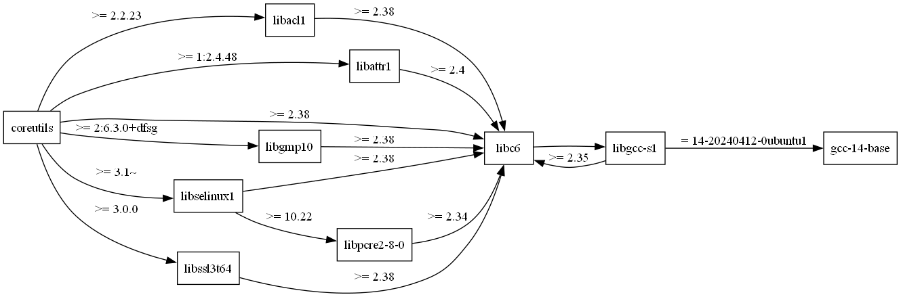
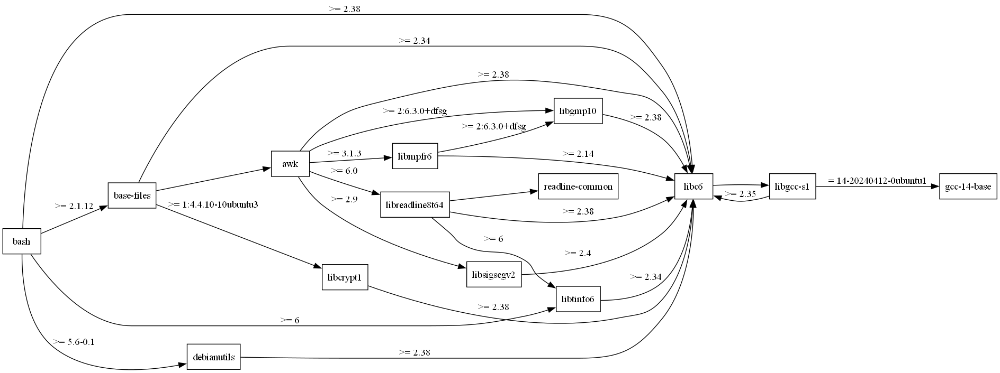
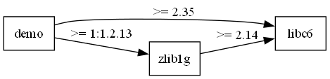

# Визуализация графа зависимостей менеджера пакетов

**Вариант №5**

## Описание проекта

Программа предназначена для анализа и визуализации графа зависимостей программных пакетов. Инструмент позволяет получать информацию о зависимостях пакетов из репозиториев Ubuntu (APT), строить граф с учетом транзитивных зависимостей, определять порядок загрузки пакетов и представлять результат в графическом или текстовом виде.

Получение информации о зависимостях реализовано самостоятельно, без использования готовых менеджеров пакетов и сторонних библиотек для анализа зависимостей.

## Реализованные этапы

### Этап 1. Минимальный прототип с конфигурацией

Реализовано CLI-приложение с настройкой параметров через командную строку.

Поддерживаются следующие параметры:
- Имя анализируемого пакета.
- URL репозитория или путь к тестовому файлу.
- Режим работы с тестовым репозиторием.
- Имя выходного PNG-файла.
- Режим отображения ASCII-дерева.
- Подстрока для фильтрации пакетов.

Добавлена проверка корректности входных параметров и обработка ошибок. Реализован вывод конфигурации в формате «ключ — значение».

### Этап 2. Сбор данных

Реализовано получение информации о пакетах и их прямых зависимостях из репозиториев Ubuntu (APT).

Добавлен механизм обработки метаданных репозитория без использования сторонних менеджеров пакетов. Полученные прямые зависимости выводятся на экран и передаются для дальнейшего анализа.

### Этап 3. Основные операции

Реализовано построение полного графа зависимостей с учетом транзитивных связей.

Основные возможности:
- Обход графа с использованием алгоритма BFS с рекурсивной реализацией.
- Фильтрация пакетов по заданной подстроке.
- Обнаружение и обработка циклических зависимостей.
- Поддержка тестового режима с загрузкой графа из файла.
- Проверка работы алгоритма на различных тестовых сценариях.

### Этап 4. Дополнительные операции

Добавлено определение порядка загрузки пакетов с учетом их зависимостей.

Реализован вывод последовательности загрузки для выбранного пакета. Проведено сравнение полученных результатов с работой штатного менеджера пакетов APT. Рассмотрены возможные различия, связанные с особенностями разрешения зависимостей и алгоритмами определения порядка установки.

### Этап 5. Визуализация

Реализована визуализация построенного графа зависимостей.

Основные возможности:
- Генерация текстового описания графа на языке PlantUML.
- Сохранение графического представления в формате PNG.
- Вывод зависимостей в виде ASCII-дерева.
- Визуализация зависимостей для трех различных пакетов.
- Сравнение полученных графов с результатами штатных инструментов визуализации APT.

#### Примеры визуализации

**1. Граф зависимостей пакета coreutils**



**2. Граф зависимостей пакета bash**



**3. Граф зависимостей пакета demo**



## Использование

Программа запускается из командной строки. Для настройки анализа используются аргументы CLI.

Пример запуска:

```bash
python main.py --package имя_пакета
```

Для получения справки по доступным параметрам:

```bash
python main.py --help
```

## Технологии

- Python
- Ubuntu